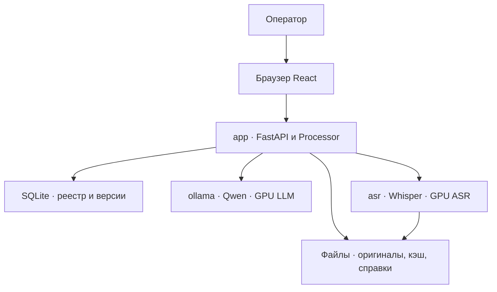
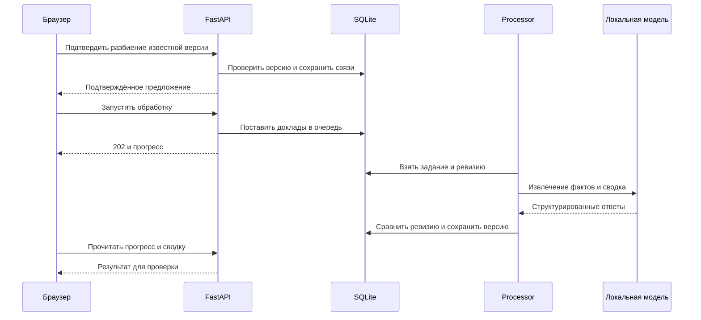

# Архитектура приложения

## Содержание документа

<!-- codebase-analysis-ai:scope:start -->
Компоненты «Репортёра», их взаимодействие, границы доступа и архитектурные решения. Раздел связывает пользовательский путь с сервером, моделями и хранилищем.
<!-- codebase-analysis-ai:scope:end -->

## Контекст

Перед созданием SQLite и запуском Processor фабрика проверяет доступ к вложенным данным от UID/GID приложения. Недоступный каталог останавливает запуск до модельных вычислений. [Диагностика и восстановление](storage-permissions.md).

Приложение объединяет веб-интерфейс и FastAPI в сервисе `app`. SQLite хранит реестр и версии, файловый каталог содержит оригиналы, кэш, изображения и справки. Один фоновый поток Processor выполняет вычислительные задания. Локальные Ollama и ASR обслуживают запросы этого потока.

Стандартное развёртывание состоит из трёх Docker-сервисов. На сервере Qwen назначается одной A100 40 ГБ, Whisper — другой. ASR необязателен: на машине с одной GPU он выключен или работает на процессоре (`ASR_MODE`), а приложение пропускает нерасшифрованные записи с предупреждением. Контейнеры получают конкретные устройства через `device_ids`. Локальные проверки на RTX 2060 использовали Qwen 4B и CPU для Whisper, что зафиксировано отдельным протоколом.

## Изменения 0.3.0

После первичного разбора и подтверждения реестра `screening` вычисляет версионный интерес отделов, `interest` направляет доклад с интересом к полной обработке, а остальные — к карточке без сводки. `report_jobs` сохраняет снимок входа и шаблона для фонового выпуска. Тот же Processor последовательно обслуживает эти очереди. Прерванные и ожидавшие задания после перезапуска приостанавливаются до команды оператора. Длительные обращения к моделям и экспорт выполняются вне транзакций. [Контракты и состояния выпуска](release-0.3.0.md).

## Компоненты

Схема показывает рабочие соединения и общие данные.

| Компонент | Ответственность | Точка входа |
| --- | --- | --- |
| React/TypeScript | Экраны, черновики, навигация, опрос задач и подтверждения | `frontend/src/main.tsx`, `App.tsx` |
| FastAPI | HTTP-контракты, валидация, транзакции, статика и ошибки | `app.create_app`, `api/` |
| Processor | Очереди выпуска, подготовки, отбора, докладов и рекомендаций, контроль ревизий | `processing.Processor` |
| SQLite | Согласованное состояние и история версий | `db.Database` |
| Storage | Адресация оригиналов и атомарная публикация артефактов | `storage.Storage` |
| Ollama | Локальная генерация структурированного текста и обработка изображений | `llm.client.OllamaClient` |
| ASR | Извлечение аудио, распознавание порциями, таймкоды и кэш | `asr_service.app` |
| LibreOffice/Tesseract | Рендеринг Office, PDF справки и OCR страниц | `office.py`, `ingest/` |

Фабрика приложения создаёт Database, Storage и Processor, подключает маршруты, обработчики ошибок и статическую сборку. Жизненный цикл запускает поток обработки и останавливает его при завершении процесса.

## Основные потоки

Веб-запросы выполняют короткие действия с состоянием либо ставят задания в очередь. Подготовка и обработка возвращают HTTP 202. Интерфейс читает прогресс отдельными запросами. Фоновый выпуск возвращает HTTP 202 и идентификатор задания, состояние восстанавливается по серверному списку. Версия публикуется после трёх форматов. Совместимый синхронный endpoint возвращает 201.

В цикле Processor сначала проверяется подготовка конференций, затем очередь докладов, затем рекомендации. Доклады берутся по `queued_at`. Каждый шаг переводит состояние задачи, выполняет извлечение или запрос к модели и сохраняет результат. Ошибки отражаются в `job` и `error`, а цикл продолжает работу.

`Database.read()` создаёт снимок чтения с `query_only`. `Database.tx()` резервирует запись через `BEGIN IMMEDIATE` и фиксирует её при успешном завершении. Для HTTP-записей зависимость имеет `scope="function"`, поэтому COMMIT завершается перед отправкой ответа. Это позволяет следующей загрузке сразу увидеть только что созданную конференцию.

Длительные вычисления моделей выполняются между транзакциями. Processor запоминает `input_revision` перед работой и сравнивает его при сохранении. Если вход изменился, старый результат уступает повторной обработке. После перезапуска незавершённые задания всех очередей (подготовка, отбор, доклады, рекомендации, справки) получают `paused` и ждут оператора: модель не начинает работу, которую в этом запуске никто не запрашивал, например на перенесённом хранилище. Журнал приложения перечисляет приостановленные задания и начало каждого нового.

## Границы и доступ

На хост публикуется веб-порт приложения, по умолчанию `127.0.0.1:18763`. Ollama и ASR доступны по именам сервисов во внутренней сети Docker. Для входа к приложению используется сеть `edge` с отключённым IP masquerade. Модели подключены для чтения, рабочие данные находятся в общем каталоге `/data` у app и ASR.

Приложение предоставляет одну рабочую область доверенному оператору. Встроенные учётные записи и разделение доступа по отделам отсутствуют в текущем API. Организация определяет доступ к веб-порту через свою сеть или шлюз. Имя отдела задаёт область рекомендации и не является учётной ролью.

Внешняя Ollama подключается отдельным профилем `app-shared` через указанную Docker-сеть. При этом приложение продолжает использовать локальные манифесты моделей и собственный ASR. Точные переменные и требования разобраны в инструкции Ollama.

## Архитектурные решения

Действующую реализацию описывают единый Python-пакет, React/Vite, FastAPI, SQLite, файловое хранилище и Ollama. Основная история упрощения записана в ADR-014. ADR-004 и ADR-009 относятся к прежнему проекту PostgreSQL-очереди. Для ADR-012 и ADR-013 отмечены частичные замещения.

Формальная запись в ADR-014 содержит принятие К1 и ожидание просмотра К2. Фактическое использование SQLite подтверждается исходниками. Эти два вида сведений отражены в каталоге решений, чтобы читатель мог проследить происхождение архитектуры.

Ключи кэша включают содержимое, версии этапов и конфигурацию. Снимки сводок и справок обеспечивают воспроизводимую историю документа. Выбор одной последовательной очереди соответствует сценарию одного оператора и размещению моделей на отдельных GPU.

## Связанные документы

- [Данные и состояния](data-model.md)
- [Подготовка материалов](processing.md)
- [Развёртывание](offline.md)

## Источники

- Фабрика и жизненный цикл. [src/rapporteur/app.py](../src/rapporteur/app.py)
- Зависимости соединений. [src/rapporteur/api/dependencies.py](../src/rapporteur/api/dependencies.py)
- Цикл и ревизии. [src/rapporteur/processing.py](../src/rapporteur/processing.py)
- Схема и соединения. [src/rapporteur/db.py](../src/rapporteur/db.py)
- Сервисы и сети. [compose.yaml](../compose.yaml)
- Среда исполнения. [Dockerfile](../Dockerfile)
- История упрощения. [docs/adr/ADR-014-simplification.md](adr/ADR-014-simplification.md)
