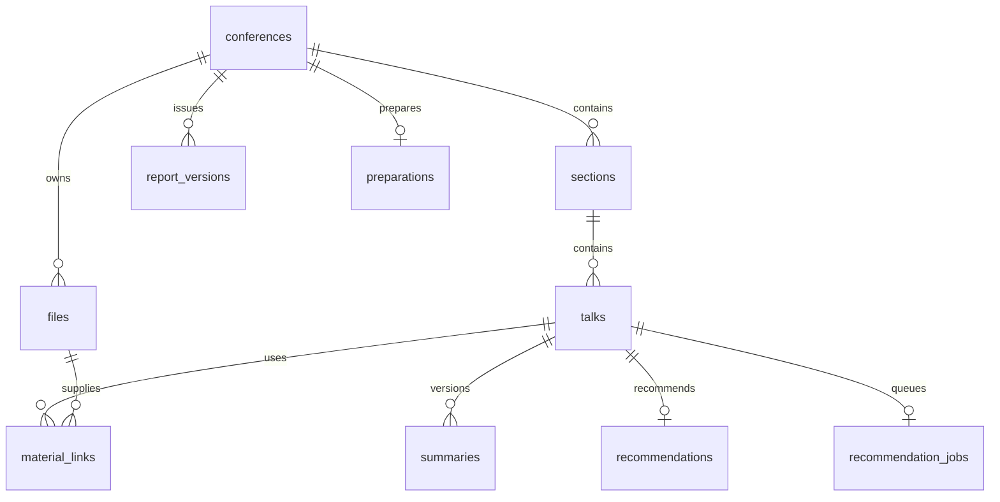
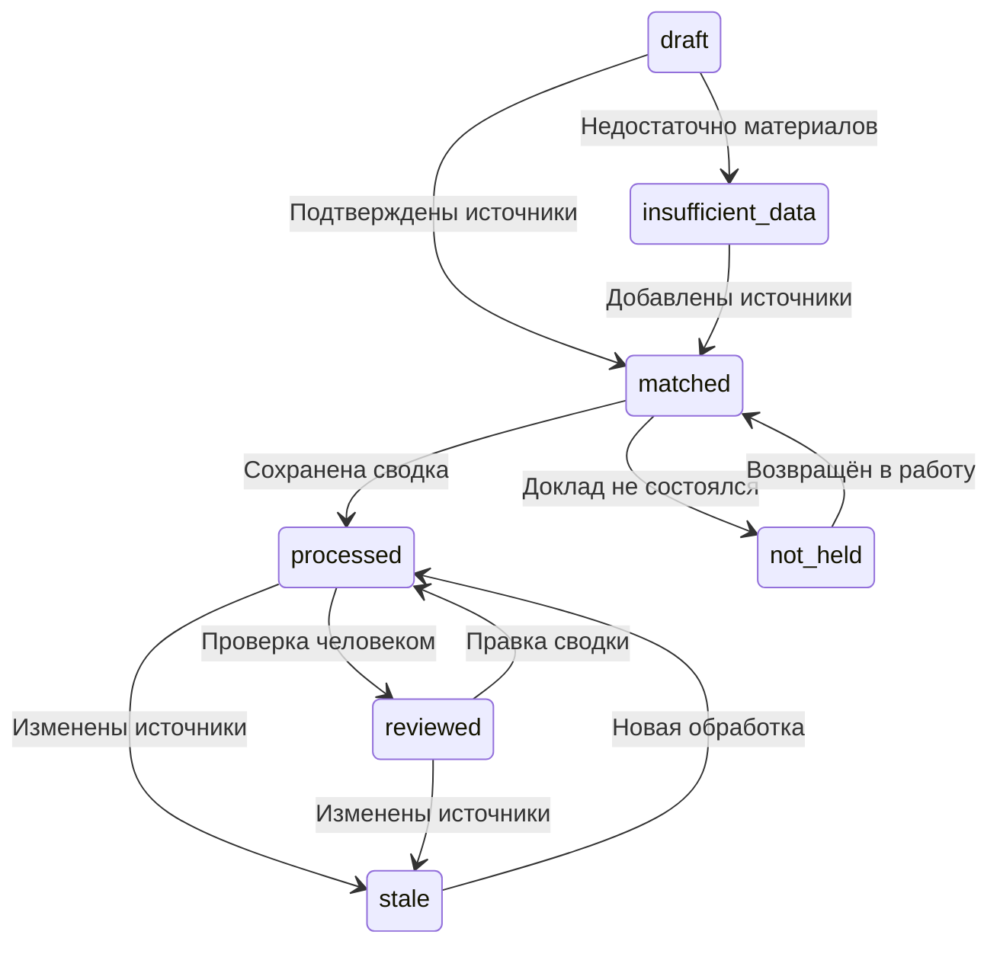

# Данные, версии и состояния

## Содержание документа

<!-- codebase-analysis-ai:scope:start -->
Предметные сущности, физическая схема SQLite, файловые артефакты, статусы и миграции. Раздел объясняет согласованность данных при правках, повторной обработке и выпуске справок.
<!-- codebase-analysis-ai:scope:end -->

## Контекст

Конференция содержит секции, доклады и материалы. Материал принадлежит конференции, а связь с докладом задаётся целым файлом или записью `material_links`. Сводка относится к докладу, справка — к конференции. Положение отдела имеет собственную историю версий.

В SQLite часть структур хранится JSON-текстом. На границе API и предметных функций Pydantic проверяет контракты. SQL-ограничения обеспечивают ключи и внешние связи, а ограничения диапазонов и ссылок в JSON проверяет код.

## Сущности

Таблицы ниже воспроизводят PRAGMA SQLite. `None` в колонке DEFAULT означает отсутствие объявленного значения по умолчанию. Флаг NOT NULL приводится буквально, включая особенности SQLite для TEXT PRIMARY KEY. Валидация API дополнительно ограничивает входные значения.

Таблицы ниже получены из временной SQLite после штатного создания схемы версии 1.

### `conferences`

Метаданные конференции и флаг запуска обработки.

| Поле | Тип SQLite | Обязательность | Первичный ключ | Значение по умолчанию |
| --- | --- | --- | --- | --- |
| `id` | `TEXT` | Допускается NULL по схеме | 1 | `None` |
| `title` | `TEXT` | Допускается NULL по схеме | - | `None` |
| `start_date` | `TEXT` | Допускается NULL по схеме | - | `None` |
| `end_date` | `TEXT` | Допускается NULL по схеме | - | `None` |
| `place` | `TEXT` | Допускается NULL по схеме | - | `None` |
| `organizer` | `TEXT` | Допускается NULL по схеме | - | `None` |
| `processing_started` | `INTEGER` | NOT NULL | - | `0` |
| `created_at` | `TEXT` | NOT NULL | - | `None` |

### `departments`

Версии положений с текстом страниц.

| Поле | Тип SQLite | Обязательность | Первичный ключ | Значение по умолчанию |
| --- | --- | --- | --- | --- |
| `id` | `TEXT` | NOT NULL | 1 | `None` |
| `version` | `INTEGER` | NOT NULL | 2 | `None` |
| `name` | `TEXT` | NOT NULL | - | `None` |
| `original_name` | `TEXT` | NOT NULL | - | `None` |
| `sha256` | `TEXT` | NOT NULL | - | `None` |
| `pages` | `TEXT` | NOT NULL | - | `None` |
| `created_at` | `TEXT` | NOT NULL | - | `None` |

### `files`

Оригиналы, пути, типы, подсказки и старые целые привязки.

| Поле | Тип SQLite | Обязательность | Первичный ключ | Значение по умолчанию |
| --- | --- | --- | --- | --- |
| `id` | `TEXT` | Допускается NULL по схеме | 1 | `None` |
| `conference_id` | `TEXT` | NOT NULL | - | `None` |
| `sha256` | `TEXT` | NOT NULL | - | `None` |
| `original_name` | `TEXT` | NOT NULL | - | `None` |
| `relative_path` | `TEXT` | NOT NULL | - | `None` |
| `kind` | `TEXT` | NOT NULL | - | `None` |
| `media_type` | `TEXT` | NOT NULL | - | `None` |
| `size_bytes` | `INTEGER` | NOT NULL | - | `None` |
| `duration_ms` | `INTEGER` | Допускается NULL по схеме | - | `None` |
| `encoding` | `TEXT` | Допускается NULL по схеме | - | `None` |
| `title_candidates` | `TEXT` | Допускается NULL по схеме | - | `None` |
| `warning` | `TEXT` | Допускается NULL по схеме | - | `None` |
| `talk_id` | `TEXT` | Допускается NULL по схеме | - | `None` |
| `confirmed` | `INTEGER` | NOT NULL | - | `0` |
| `confidence` | `REAL` | Допускается NULL по схеме | - | `None` |

### `material_links`

Связи файла и доклада с временными или страничными границами.

| Поле | Тип SQLite | Обязательность | Первичный ключ | Значение по умолчанию |
| --- | --- | --- | --- | --- |
| `id` | `TEXT` | Допускается NULL по схеме | 1 | `None` |
| `file_id` | `TEXT` | NOT NULL | - | `None` |
| `talk_id` | `TEXT` | NOT NULL | - | `None` |
| `start_ms` | `INTEGER` | Допускается NULL по схеме | - | `None` |
| `end_ms` | `INTEGER` | Допускается NULL по схеме | - | `None` |
| `page_start` | `INTEGER` | Допускается NULL по схеме | - | `None` |
| `page_end` | `INTEGER` | Допускается NULL по схеме | - | `None` |

### `preparations`

Версия предложения и состояние подготовки конференции.

| Поле | Тип SQLite | Обязательность | Первичный ключ | Значение по умолчанию |
| --- | --- | --- | --- | --- |
| `conference_id` | `TEXT` | Допускается NULL по схеме | 1 | `None` |
| `version` | `INTEGER` | NOT NULL | - | `1` |
| `job` | `TEXT` | NOT NULL | - | `None` |
| `error` | `TEXT` | Допускается NULL по схеме | - | `None` |
| `proposal` | `TEXT` | NOT NULL | - | `'[]'` |

### `recommendation_jobs`

Очередь расчёта рекомендаций.

| Поле | Тип SQLite | Обязательность | Первичный ключ | Значение по умолчанию |
| --- | --- | --- | --- | --- |
| `talk_id` | `TEXT` | Допускается NULL по схеме | 1 | `None` |
| `job` | `TEXT` | NOT NULL | - | `None` |
| `error` | `TEXT` | Допускается NULL по схеме | - | `None` |

### `recommendations`

Текущий расчёт, версия сводки, версии отделов и флаг проверки.

| Поле | Тип SQLite | Обязательность | Первичный ключ | Значение по умолчанию |
| --- | --- | --- | --- | --- |
| `talk_id` | `TEXT` | Допускается NULL по схеме | 1 | `None` |
| `summary_version` | `INTEGER` | NOT NULL | - | `None` |
| `department_revisions` | `TEXT` | NOT NULL | - | `None` |
| `version` | `INTEGER` | NOT NULL | - | `None` |
| `items` | `TEXT` | NOT NULL | - | `None` |
| `reviewed` | `INTEGER` | NOT NULL | - | `0` |

### `report_versions`

Версии справок, снимки входа, файлы и предупреждения.

| Поле | Тип SQLite | Обязательность | Первичный ключ | Значение по умолчанию |
| --- | --- | --- | --- | --- |
| `id` | `TEXT` | Допускается NULL по схеме | 1 | `None` |
| `conference_id` | `TEXT` | NOT NULL | - | `None` |
| `number` | `INTEGER` | NOT NULL | - | `None` |
| `input` | `TEXT` | NOT NULL | - | `None` |
| `variables` | `TEXT` | NOT NULL | - | `None` |
| `files` | `TEXT` | NOT NULL | - | `None` |
| `warnings` | `TEXT` | NOT NULL | - | `None` |
| `created_at` | `TEXT` | NOT NULL | - | `None` |

### `sections`

Секции, дата и порядок внутри конференции.

| Поле | Тип SQLite | Обязательность | Первичный ключ | Значение по умолчанию |
| --- | --- | --- | --- | --- |
| `id` | `TEXT` | Допускается NULL по схеме | 1 | `None` |
| `conference_id` | `TEXT` | NOT NULL | - | `None` |
| `title` | `TEXT` | NOT NULL | - | `None` |
| `date` | `TEXT` | Допускается NULL по схеме | - | `None` |
| `position` | `INTEGER` | NOT NULL | - | `None` |

### `settings`

Выбор модели из интерфейса.

| Поле | Тип SQLite | Обязательность | Первичный ключ | Значение по умолчанию |
| --- | --- | --- | --- | --- |
| `key` | `TEXT` | Допускается NULL по схеме | 1 | `None` |
| `value` | `TEXT` | NOT NULL | - | `None` |

### `summaries`

Версии сводки и соответствующего пакета фрагментов.

| Поле | Тип SQLite | Обязательность | Первичный ключ | Значение по умолчанию |
| --- | --- | --- | --- | --- |
| `talk_id` | `TEXT` | NOT NULL | 1 | `None` |
| `number` | `INTEGER` | NOT NULL | 2 | `None` |
| `summary` | `TEXT` | NOT NULL | - | `None` |
| `pack` | `TEXT` | NOT NULL | - | `None` |
| `created_at` | `TEXT` | NOT NULL | - | `None` |

### `talks`

Реестр докладов, авторы, предметный статус и состояние очереди.

| Поле | Тип SQLite | Обязательность | Первичный ключ | Значение по умолчанию |
| --- | --- | --- | --- | --- |
| `id` | `TEXT` | Допускается NULL по схеме | 1 | `None` |
| `section_id` | `TEXT` | NOT NULL | - | `None` |
| `position` | `INTEGER` | NOT NULL | - | `None` |
| `title` | `TEXT` | Допускается NULL по схеме | - | `None` |
| `date` | `TEXT` | Допускается NULL по схеме | - | `None` |
| `status` | `TEXT` | NOT NULL | - | `'draft'` |
| `speakers` | `TEXT` | NOT NULL | - | `'[]'` |
| `import_folder` | `TEXT` | Допускается NULL по схеме | - | `None` |
| `job` | `TEXT` | Допускается NULL по схеме | - | `None` |
| `step` | `TEXT` | Допускается NULL по схеме | - | `None` |
| `error` | `TEXT` | Допускается NULL по схеме | - | `None` |
| `queued_at` | `TEXT` | Допускается NULL по схеме | - | `None` |
| `input_revision` | `INTEGER` | NOT NULL | - | `0` |
| `organizations` | `TEXT` | NOT NULL | - | `'[]'` |
| `contacts` | `TEXT` | NOT NULL | - | `'[]'` |
| `card_only` | `INTEGER` | NOT NULL | - | `0` |

`speakers` хранит JSON-список авторов: `name`, `role` (`speaker` или `coauthor`), `affiliation` и `contacts`. `organizations` и `contacts` доклада — сведения карточки, не отнесённые к конкретному автору (миграция v3). `card_only` — итог последней обработки: доклад без интереса отделов получил только карточку (миграция v4, `interest.py`).

## Связи и состояния

Связи раскрываются на двух уровнях. Обычные связи conference/section/talk/file обеспечены внешними ключами SQLite. Рекомендации ссылаются на отделы и факты внутри JSON и проверяются функцией `departments.validate`.

### Независимые состояния

| Измерение | Значения | Что означает |
| --- | --- | --- |
| Доклад `talks.status` | `draft`, `matched`, `processed`, `reviewed`, `stale`, `not_held`, `insufficient_data` | Состояние содержания и проверки |
| Задание доклада `job` | NULL, `queued`, `running`, `done`, `failed` | Состояние вычислительной задачи |
| Текущий шаг `step` | `parse`, `facts`, `verify`, `summary` или NULL | Где находится обработка |
| Подготовка `preparations.job` | `queued`, `running`, `done`, `failed`, `confirmed` | Предложение и его подтверждение |
| Сводка `summary.status` | `ready`, `needs_attention`, `stale` | Результат проверок текста |
| Утверждение `claim.status` | `rejected`, `verified`, `needs_human`, `confirmed` | Состояние опоры и проверки человеком |
| Рекомендация | `reviewed`, вычисляемый `stale`, отдельное задание | Подтверждение и актуальность расчёта |

`job=done` означает завершение задачи. Допуск массового подтверждения дополнительно зависит от статуса доклада, сводки и утверждений. Поле `summary_status` в прогрессе не заменяет статус доклада.

Граф отражает основные предметные переходы. Таблица `TALK_TRANSITIONS` задаёт допустимые переходы контракта, а подтверждение разбиения дополнительно выполняет массовые SQL-обновления затронутых докладов. Сценарий отсутствия источников приводит к `insufficient_data`.

### Идентификаторы и ревизии

Случайные идентификаторы конференций, секций и новых докладов создаются как UUID4. `source_file_id` детерминирован по конференции и SHA-256. Идентификатор фрагмента зависит от файла, вида и локатора, ревизия — от нормализованного текста. Метка `c1` имеет смысл внутри конкретной сводки и пакета.

`talks.input_revision` меняется при изменении входов и метаданных. Processor снимает её перед работой и сравнивает перед сохранением. Метаданные доклада используют поле `revision`, сводка и рекомендации — `version`, предложение — собственный `version`. Эти счётчики относятся к разным объектам.

Правка темы и авторов обновляет реестр и `input_revision`. Правка проверенной сводки создаёт новую версию и переводит доклад обратно в `processed`. Подтверждение сводки создаёт ещё одну версию. Актуальность рекомендаций вычисляется по текущей версии сводки и словарю версий отделов.

## Хранение

Рабочее хранилище определяется `RAPPORTEUR_STORAGE` на хосте и подключается как `/data`.

| Объект | Расположение или ключ | Срок жизни |
| --- | --- | --- |
| База | `rapporteur.db`, возможные `-wal`, `-shm` | Рабочее состояние |
| Бэкап миграции | `rapporteur.db.before-vN.bak` | Снимок перед миграцией схемы до версии N |
| Оригинал | `blobs/<SHA-256>` | Контент-адресуемый файл |
| Слайды и страницы | `slides/...`, `pages/<sha>/page-NNN.png` | Доступны для проверки источников |
| Подготовленное содержимое | `cache/prepared/...json` | По версии извлечения, содержимому, назначению и профилю |
| Визуальные описания | `cache/vision/...json` | По странице и профилю |
| ASR | `cache/asr/...json` | По исходнику, ревизии ASR и порции |
| Факты и части | `cache/facts/...`, `cache/facts-parts/...` | По входам и настройкам |
| Сводка вычисления | `cache/summary/...json` | По фактам и конфигурации |
| Справка | `reports/<version_id>/...` | Неизменяемые файлы версии |
| Временные загрузки | `tmp/` | Во время приёма файла |

Кэш Storage читается с валидацией модели. Нечитаемый JSON или несовместимый контракт приводит к вычислению заново. Запись сначала создаёт временный файл и затем выполняет атомарное `os.replace`. Оригинал публикуется через `os.link` со staging того же тома. Для рабочего хранилища нужна файловая система Linux с соответствующей семантикой.

Удаление конференции каскадно удаляет предметные строки. Контент-адресуемые файлы и кэш могут физически оставаться на диске. Отдельная автоматическая сборка неиспользуемых файлов в текущем пути удаления не выполняется. Это следует учитывать при планировании места и обслуживании.

Полный бэкап выполняется при остановленном приложении и включает весь каталог. При переносе одной БД теряются оригиналы, кэш страниц и файлы справок. При откате версии приложения используется соответствующий полный бэкап.

## Дополнительные записи 0.3.0

`talk_screenings` хранит историю версионного предварительного отбора по докладам, ревизии материалов, положений и профиля. `report_jobs` хранит снимок входов и шаблона, ключ идемпотентности, этап, попытку, ошибку и ссылку на выпущенную версию. Успешная публикация версии и завершение задания атомарны. [Поля и переходы состояний](release-0.3.0.md).

## Миграции

При создании Database включается WAL, выполняется базовая схема и проверяется `PRAGMA user_version`. Для версии ниже 1 SQLite backup сохраняет текущую базу вместе с зафиксированным WAL. Затем транзакция добавляет `input_revision`, интервальные связи, подготовку, отделы и рекомендации. Успешная миграция устанавливает `user_version=1`.

Начиная с 0.3.0 шаги схемы перечислены в `_MIGRATIONS`, перед каждым шагом N сохраняется `rapporteur.db.before-vN.bak`. Миграция v2 создаёт `talk_screenings` и `report_jobs`. Миграция v3 добавляет в `talks` списки `organizations` и `contacts` карточки доклада. Миграция v4 добавляет `card_only`. Каждый шаг выполняется в своей транзакции и устанавливает `user_version` своего номера. Повторный старт пропускает уже выполненные шаги. Прерывание внутри транзакции откатывает изменения. Фикстура старой установки проверяет открытие ручного реестра, сводок, разбиения и скачивание старых справок с исходными SHA-256.

## Связанные документы

- [Потоки и транзакции](architecture.md)
- [Версионные запросы](api.md)
- [История справок](recommendations-report.md)

## Источники

- SQL-схема и миграция. [src/rapporteur/db.py](../src/rapporteur/db.py)
- Предметные состояния. [src/rapporteur/contracts/enums.py](../src/rapporteur/contracts/enums.py)
- Детерминированные идентификаторы. [src/rapporteur/contracts/ids.py](../src/rapporteur/contracts/ids.py)
- Ревизии фрагментов. [src/rapporteur/summarize/pack.py](../src/rapporteur/summarize/pack.py)
- Файлы и кэш. [src/rapporteur/storage.py](../src/rapporteur/storage.py)
- Привязки и реестр. [src/rapporteur/materials.py](../src/rapporteur/materials.py)
- История правок. [src/rapporteur/summaries.py](../src/rapporteur/summaries.py)
- Актуальность рекомендаций. [src/rapporteur/departments.py](../src/rapporteur/departments.py)
- Совместимость и восстановление. [tests/test_upgrade.py](../tests/test_upgrade.py)
