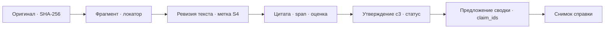

# Факты, доказательства и сводки

## Содержание документа

<!-- codebase-analysis-ai:scope:start -->
Построение пакета источников, извлечение фактов, сверка цитат, составление сводки и проверка человеком. Раздел объясняет происхождение каждого утверждения и пределы автоматических проверок.
<!-- codebase-analysis-ai:scope:end -->

## Контекст

Материалы становятся доказательной базой через пакет фрагментов одного доклада. У каждого фрагмента есть текст, происхождение, файл, локатор и ревизия. Модель возвращает факты с метками и цитатами. Код проверяет, что эти цитаты действительно находятся в соответствующих фрагментах.

Такая сверка устанавливает прослеживаемость к загруженному материалу. Содержательная корректность интерпретации, качество источника и правдивость докладчика оцениваются человеком. В исследовательском описании эти уровни проверки должны иметь самостоятельные определения.

## Ответственность компонентов

`summarize.pack` создаёт метки и идентификаторы. `summarize.facts` запрашивает структурированные факты. `summarize.quotes` ищет цитаты, а `summarize.verify` присваивает статусы. `summarize.summary` составляет предложения по допустимым утверждениям и проводит проверки. `summaries.py` сохраняет правки и подтверждение человека.

Активные профили выбирают редакцию v3: `facts/v3.md`, `facts-review/v3.md`, `summary/v3.md` и `critic/v3.md`. Редакции v1 и v2 сохранены для исторических профилей. Схемы Pydantic проверяют форму и связи полей. Интерфейс показывает цитату и источник для выбранного утверждения.

## Как это работает

### Пакет и происхождение

Метки `S` обозначают текст слайдов, `D` — страницы документов/фотографий после извлечения или OCR, `T` — стенограмму, `N` — заметки, `V` — визуальное описание. Номер файла добавляется при нескольких источниках. Например, `S4` — слайд 4 единственной презентации, `S2.4` — слайд 4 второй, `T1.00:00:09` — фрагмент первой записи с девятой секунды.

Пустые фрагменты пропускаются. Идентификатор фрагмента выводится из файла, его вида и локатора. Идентификатор ревизии дополнительно зависит от нормализованного текста. Это позволяет отличать одно место источника от конкретной редакции его содержания.

### Извлечение фактов

Черновик фактов содержит проблему, методы, результаты, выводы, реплики слушателей, неопределённости и подсказки к метаданным. Каждая содержательная запись содержит одну или несколько опор `label` и `quote`. JSON Schema перечисляет существующие метки пакета. Python дополнительно проверяет принадлежность меток и ограничения ответа. В одном ответе допускается до 3 методов, 5 результатов, 3 выводов и 2 реплик слушателя. Текст факта ограничен 350 символами, каждая из двух допустимых цитат — 240 символами. Эти ограничения применяются при генерации, сохранённые старые данные читаются по прежнему контракту.

Для короткого входа применяется JSON Schema и до двух исправлений после первого ответа. Длинный вход делится на порции по вычисляемому символьному бюджету, максимум 24 000 символов. Отдельный фрагмент может быть разделён на части. Частичные факты кэшируются, затем объединяются попарно с сохранением меток и цитат. Переполнение при объединении возвращается как контролируемая ошибка.

В режиме v2 отдельный запрос пересматривает факты по исходному контексту. Он сохраняет оговорки, модальность и различия выполненных действий и желаемых итогов. При объединении частей используются относящиеся к цитатам источники. Для длинного фрагмента в модель передаются начало и окна вокруг цитат, исходный пакет сохраняется целиком для сверки.

`ask_structured` оценивает бюджет перед каждым запросом, включая исправления растущего диалога примерно по четырём символам на токен с резервом на ответ. Реальные счётчики ответа проверяются отдельно. Обрезание по токенам, неверная структура и исчерпание контекста имеют устойчивые коды ошибок. Порционная обработка не даёт гарантии для входа произвольного размера.

### Сверка цитат

Код нормализует поисковую форму цитаты и фрагмента, ищет лучший участок через RapidFuzz и возвращает положение в исходном нормализованном тексте. По умолчанию длина поисковой цитаты должна быть не меньше 10 символов. Оценка ниже 0,6 означает отсутствие цитаты, оценка от 0,6 до 0,9 недостаточна для принятия. При оценке от 0,9 дополнительно проверяются числовые токены и отрицания.

Для утверждения достаточно одной прошедшей опоры. Отсутствие допустимой опоры даёт `rejected`. Опора только на `V` даёт `needs_human`. Обычная прошедшая сверка даёт `verified`. После проверки человеком использованные утверждения получают `confirmed`.

Числовое совпадение и отрицания проверяются внутри найденного контекста. Код также сохраняет отклонённые опоры с причинами `label_not_found`, `quote_not_found`, `below_threshold`, `number_mismatch`, `negation_mismatch`, `too_short`. Наличие цитаты само по себе не измеряет логическое следование всего утверждения.

### Составление сводки

Для основного текста доступны утверждения, прошедшие допустимость, кроме реплик слушателей. Модель получает набор утверждений с ключами `c1`, `c2` и далее. Режим v2 передаёт также цитаты и контекст источников. Для ASR добавляются предыдущий и следующий сегменты той же записи и блока, чтобы сохранить связанные оговорки. Каждое предложение содержит `claim_ids`, выводы тоже связаны с утверждениями.

Длина и содержание сводки задаются файлом `summary.yaml` (раздел «Содержание сводки» ниже). Штатный диапазон — 4–5 предложений. При малом количестве доступных утверждений нижняя граница уменьшается вплоть до одного. Проверяются допустимость ссылок, число предложений, числа в привязанных источниках и запрещённые формулировки. Число из другого фрагмента доклада больше не подтверждает предложение. В v2 после этих проверок смысловой критик той же моделью сопоставляет каждую строку с её источниками. Для каждой строки требуется ровно одно решение, замечания участвуют в цикле исправлений. На исправление содержательных проверок отводится до трёх попыток, внутри попытки допускается одно исправление формы JSON.

### Содержание сводки

Выводы и результаты автора интереснее общего описания доклада. `summary.yaml` задаёт порядок важности типов утверждений (`priorities`, по умолчанию вывод, результат, метод, задача) и число обязательных утверждений каждого типа (`required`, по умолчанию до трёх выводов и до трёх результатов, если их столько есть). Модель получает утверждения в порядке важности и перечень обязательных ключей. Проверка `coverage` возвращает сводку на доработку с пропущенными ключами. Факты v3 в первую очередь сохраняют выводы и конкретные результаты.

Читатель справки не видел доклада, поэтому сокращение без расшифровки ему непонятно. `summarize/terms.py` ищет расшифровки в материалах доклада: «полное название (СУБД)», «СУБД (полное название)», «СУБД — определение». Модель получает найденные расшифровки и список сокращений без расшифровки, которые в тексте не используются. Проверка `abbreviations` требует расшифровку при первом упоминании, кроме общеизвестных сокращений и единиц из `known_abbreviations`. Критик видит фрагмент с расшифровкой вместе с источниками строки. Правило включает `explain_abbreviations: true`. Узкие термины и условные обозначения без заглавных букв код не распознаёт: их пояснение задаёт промпт, соблюдение проверяет оператор.

Настройки входят в ключ кэша сводки. После правки файла и пересборки образа доклады при следующей обработке получают новую сводку, прежние версии сохраняются.

### Сводка или только карточка

Сводку получает доклад, интересный хотя бы одному отделу. Остальным достаточно карточки: темы, авторов, организаций и контактов. Решение принимает классификация отделов через `interest.classify`. Пока классификация не подключена, она возвращает «нет решения», и сводка делается всем докладам. Оператор переопределяет решение на этапе «Проверка»: «по интересу отделов», «сводка» или «только карточка». Доклад только с карточкой не обращается к модели после сборки пакета, получает `processed` и признак `card_only`. Справка выводит его без сводки и без подтверждения непроверенных сводок: карточку оператор подтвердил на этапе «Доклады».

### Итог проверок

Если проверки пройдены, сводка получает `ready`. Решение критика сохраняется в `checks` с именем `critic`. Такой статус характеризует автоматические проверки выбранной модели. Проверка оператором остаётся этапом допуска в справку. При исчерпании попыток приоритет выбора имеют допустимые ссылки и число предложений, затем число замечаний. Сохраняется связанный вариант с `needs_attention`. При отсутствии пригодных утверждений текст может остаться пустым. Такой результат требует работы оператора.

### Человеческая проверка

Редактирование создаёт новую версию сводки с `human_edit=true`. Изменение текста утверждения переводит его в `needs_human`. Проверка использует номер прочитанной версии. Конфликт возвращает 409. Подтверждение отклоняется во время `queued/running` и при неподходящем статусе доклада.

Индивидуальное подтверждение переводит использованные допустимые утверждения в `confirmed` и доклад в `reviewed`. Массовое подтверждение допускает актуальные сводки `ready` у докладов `processed` с непустым текстом, завершённой обработкой и без `needs_human`. Для каждого пропуска возвращается причина.

## Доступные функции

Пример из вымышленных тестовых материалов описывает исследование кэширования. На слайде `S4` указано «при нагрузке 1000 запросов в секунду политика LFU снизила задержку на 23 %». Факт результата получает эту цитату, код находит её в `S4`, а предложение сводки связывается с ключом утверждения. При выборе ключа оператор видит исходный текст и страницу.

Заметка о холодном старте помещается в отдельный контекст реплики слушателя. Она помогает проверке, а основной текст формируется по подходящим типам утверждений. Темы и авторы справки берутся из реестра, который проверяет оператор.

Локальные тесты покрывают искажение чисел, отрицаний, отсутствие метки, визуальные опоры, длинные входы, кэширование и конфликт версий. Качество полного смыслового пересказа на реальных конференциях требует размеченного набора и экспертной оценки.

## Связанные документы

- [Подготовка источников](processing.md)
- [Рекомендации и экспорт](recommendations-report.md)
- [Методическая часть](research.md)

## Источники

- Пакет и метки. [src/rapporteur/summarize/pack.py](../src/rapporteur/summarize/pack.py)
- Факты и порции. [src/rapporteur/summarize/facts.py](../src/rapporteur/summarize/facts.py)
- Поиск и пороги цитат. [src/rapporteur/summarize/quotes.py](../src/rapporteur/summarize/quotes.py)
- Статусы утверждений. [src/rapporteur/summarize/verify.py](../src/rapporteur/summarize/verify.py)
- Генерация сводки. [src/rapporteur/summarize/summary.py](../src/rapporteur/summarize/summary.py)
- Смысловой критик. [src/rapporteur/summarize/grounding.py](../src/rapporteur/summarize/grounding.py)
- Регрессии контекста и генерации. [tests/test_grounded_summary.py](../tests/test_grounded_summary.py)
- Проверки результата. [src/rapporteur/summarize/checks.py](../src/rapporteur/summarize/checks.py)
- JSON и бюджет. [src/rapporteur/llm/structured.py](../src/rapporteur/llm/structured.py)
- Контракты доказательств. [src/rapporteur/contracts/claims.py](../src/rapporteur/contracts/claims.py)
- Вымышленный пример. [tests/fictional_talk.py](../tests/fictional_talk.py)
- Проверки сверки. [tests/test_verify.py](../tests/test_verify.py)
